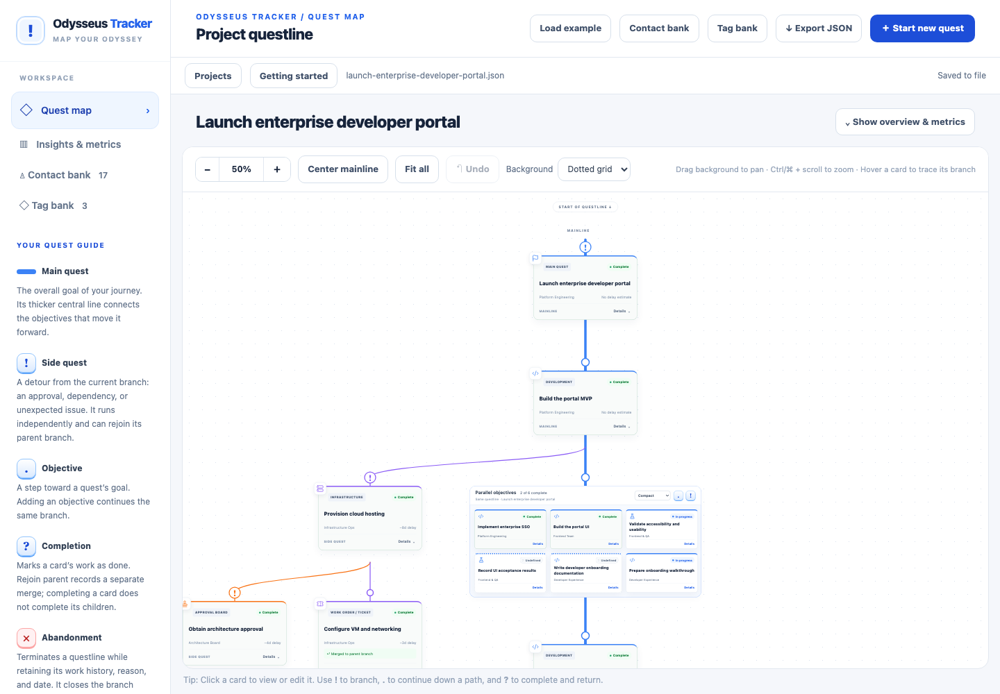
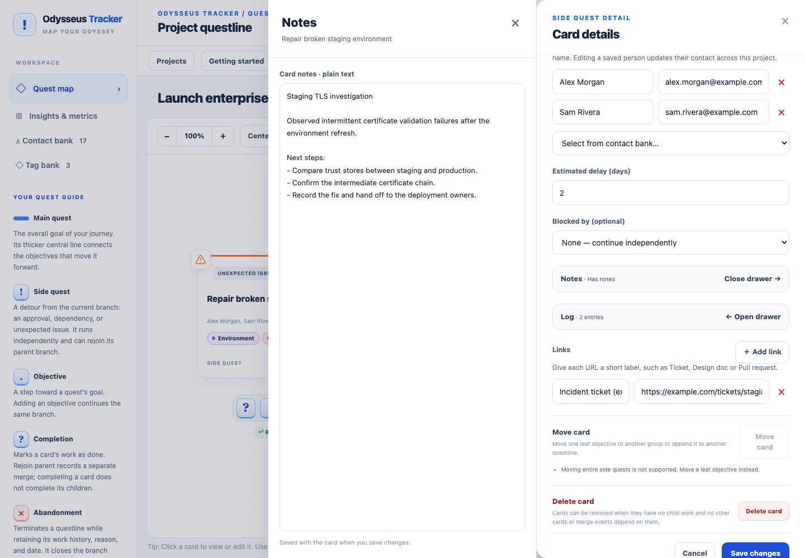

# Odysseus Tracker

**Map the work behind the goal.**

A delivery goal rarely travels in a straight line. Launching a service can lead to security reviews, infrastructure tickets, approvals, dependencies, and unexpected issues. Odysseus Tracker makes that supporting work visible as a map of objectives, side quests, parallel work, and rejoins.

Follow the main questline, see where effort branches out, and keep a record of what happened along the way. Run it locally in your browser from a single Go executable, with your projects saved as JSON files on your computer.



[Explore the illustrated user guide](docs/USER-GUIDE.md) · [Installation and configuration](docs/LOCAL-APPLICATION.md) · [Changelog](CHANGELOG.md)

## Why use it?

A flat task list can hide the work created by a delivery goal. Odysseus Tracker shows how that work relates: which objectives advance the goal, which detours support it, which tasks run alongside one another, and which dependencies actually block progress.

It is useful for service launches, developer platforms, infrastructure provisioning, review-heavy delivery, and projects where the history of a detour matters as much as its outcome.

## What you can do

- **Map delivery:** build a central questline with independent side quests, nested branches, parallel groups, and historical merges.
- **Make dependencies explicit:** connect blockers and distinguish unresolved dependencies from completed ones.
- **Keep context with the work:** add owners, colored tags, links, notes, delay estimates, and timestamped progress logs.
- **Track outcomes:** follow work through Planning, Ready, In Progress, In Review, and Complete, or record why and when a questline was abandoned.
- **Explore your map:** pan, zoom, center, fit the graph, adjust group density, and choose a dotted grid, plain background, or map backdrop.
- **Keep projects local:** create and switch between project files, resume the last project, undo session edits, export JSON backups, and print expanded quest maps as PDFs.

The built-in example walks through an enterprise developer portal launch, including reviews, observability work, parallel objectives, blockers, and unexpected issues.

## Get started

Build from the repository root with Go 1.24 or newer:

```sh
go build -trimpath -o dist/odysseus-tracker .
./dist/odysseus-tracker
```

On Windows:

```powershell
go build -trimpath -o dist/odysseus-tracker.exe .
.\dist\odysseus-tracker.exe
```

Open the URL printed in your terminal, normally `http://127.0.0.1:8042`. The first launch shows a welcome guide. Choose **Start new quest** to create your own project or **Load example** to explore a populated map. Later launches reopen your last selected project. Stop the process with Ctrl+C.

The executable embeds the frontend and styling assets. It needs no Go installation, Node.js, repository, or internet connection at runtime. Your browser displays the interface; the Go process handles local files.

## Your data, on your computer

Application settings live in `config.yaml`; each project lives in its own JSON file. The default location is your per-user configuration folder. Use an alternate folder or port when needed:

```sh
./dist/odysseus-tracker --data-dir ./tracker-data --listen 127.0.0.1:8043
```

Applied edits save automatically in the background. If a save fails, editing stays available in memory with retry and export controls. **Export JSON** creates a portable copy of the active project.

See the [local application guide](docs/LOCAL-APPLICATION.md) for file locations, settings, backups, and migration from the original browser-storage prototype.

## Learn the features

The [illustrated user guide](docs/USER-GUIDE.md) covers creating a project, reading the map, adding work, using groups and blockers, editing card details, managing contacts/tags, viewing insights, and protecting your saved work.



## Current scope

Odysseus Tracker is a local application for one active project at a time, with a library of separate project files. It has no accounts, cloud synchronization, or simultaneous collaboration. Notes and logs are plain text. Moving work is limited to eligible leaf objectives; there is no arbitrary drag-and-drop ordering or cascade deletion.

Delay totals are manually estimated cumulative work, not a critical-path calculation or a calendar forecast. Undo lasts for the current project session; it is not durable audit history. There is no import dialog yet, though compatible exports can be opened from the projects folder.

## Development and documentation

The frontend retains the accepted prototype's graph and editor behavior. Go embeds the application and provides local configuration and file persistence.

- [Architecture and project history](docs/README.md)
- [Product requirements](docs/REQUIREMENTS.md)
- [Potential features](docs/potential-features.md): ten proposed single-user enhancements
- [Design decisions](docs/DESIGN-DECISIONS.md)
- [Testing and validation](docs/TESTING.md)
- [Contributor instructions](AGENTS.md)

Frontend checks use Node.js 22 or newer and Playwright:

```sh
npm ci
npm run test:browser:install
npm test
npm run build:local
npm run test:local
go test -race ./...
go vet ./...
```

Screenshot capture instructions are in [the guide image notes](docs/guide-images/README.md). Development and screenshot tools are not runtime dependencies.
