# Odysseus Tracker user guide

Odysseus Tracker maps a goal and the work that grows around it. This guide uses the built-in enterprise developer portal example. Screenshots show the local Go application with sample data, not personal projects.

[Start and configure the application](LOCAL-APPLICATION.md) · [Return to the project overview](../README.md)

## 1. Start your first quest

Run the executable and open the browser URL printed in the terminal. The first-run welcome explains the map and its main actions. Select **Get started** to open the new-project editor. You can reopen the welcome through **Getting started**.

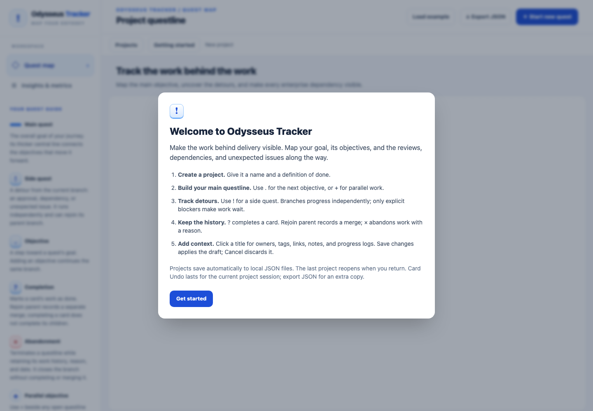

Give your project a name, describe its goal or definition of done, and choose a questline color. Scroll to the editor footer and select **Create questline** to start its main quest. **Cancel** discards the draft. To explore before creating your own map, cancel the editor and select **Load example**.

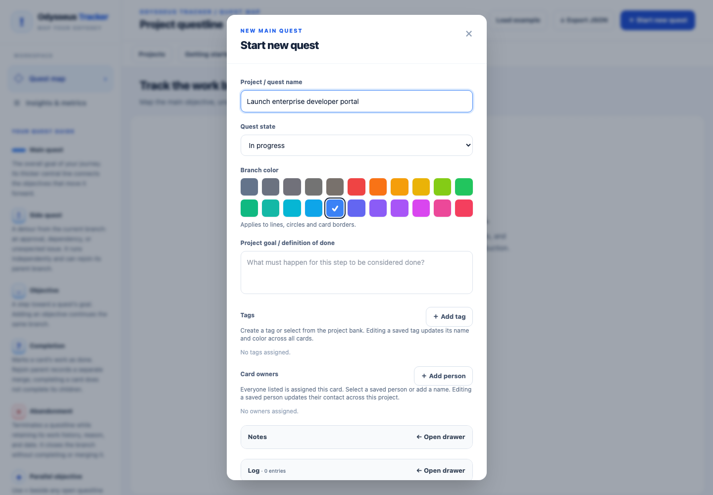

Loading the example into an existing project asks for confirmation and replaces that project's contents. Use a separate new project if you want to explore without replacing your work. Replacement within the current session supports Undo.

## 2. Read the quest map

The thicker central line is the **main questline**. Objectives along it advance the primary goal. **Side quests** branch away to record supporting or unexpected work; they can have their own objectives, parallel groups, and nested branches.

A side quest does not automatically block its parent. Dependencies are separate, explicit relationships. A branch can continue independently and later **Rejoin parent**, returning to the questline it originated from. Completed merges retain their historical position as later work is added.

Hover a card to trace its related branch. Use the toolbar's zoom controls, **Center mainline**, and **Fit all** to explore. Drag empty background to pan; Ctrl/⌘ + scroll zooms. Collapse **overview & metrics** when you want more map space.

## 3. Add objectives, branches, and parallel work

At an eligible open endpoint, the map offers these actions:

| Action | What it does |
| --- | --- |
| `.` | Add the next serial objective on this questline |
| `!` | Create an independent side quest |
| `?` | Complete the current card's work |
| `×` | Abandon the questline with a reason and timestamp |
| Rejoin parent | Merge a side questline back into its originating parent |

Parallel work belongs in a **group**, rather than being presented as unrelated branches. Use the parallel action beside an eligible objective to start alongside it. Within a group, the header's `.` adds another parallel objective and `!` adds a side quest. Normal continuation and completion controls appear below an open group when it has no existing serial continuation.

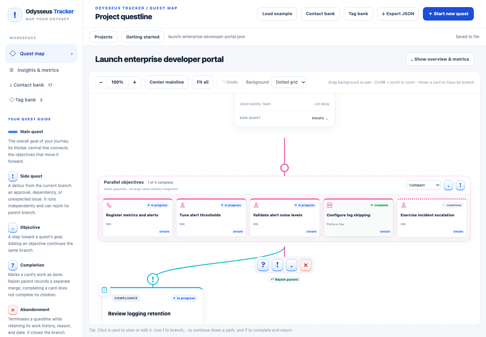

Groups support **Normal**, **Compact**, and **Very compact** display modes. Their grids stay balanced with at most three rows; scroll horizontally to reach additional members. Click a card title to open full details in any density.

## 4. Edit a card and its dependencies

Click a card title to open the detail drawer. Set its title, description, work category, status, delay estimate, owners, tags, links, and blocker. **Save changes** applies the draft and queues a local-file save; **Cancel** discards the draft.

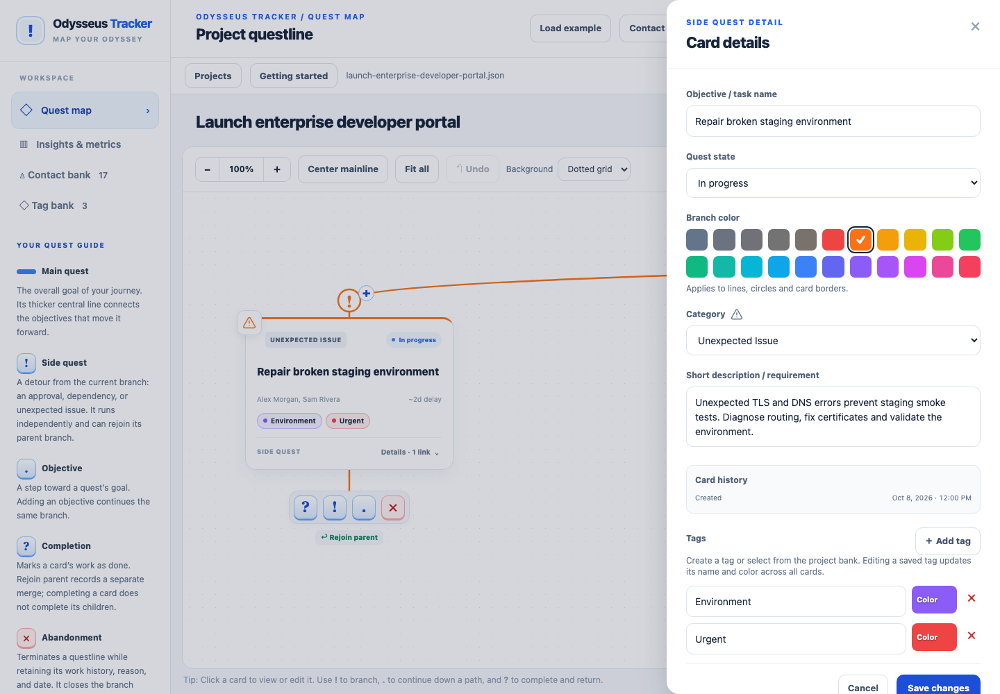

Choose **In progress**, **Undefined**, or **Complete** as appropriate. Blocked presentation is derived from an explicit blocker whose work is not complete. Dependency lines remain visible when a blocker is complete, with resolved dependencies distinguished visually.

Categories describe the kind of work, while questline colors describe the branch it belongs to. Completing a card is separate from merging a side quest back into its parent. Completion and merge timestamps preserve that distinction.

## 5. Keep notes and a progress log

Use **Notes** for longer plain-text context. On a wide screen, the notes drawer sits beside card details; on a narrow screen it opens as an overlay.

Use **Log** to record timestamped progress or status updates. Entries display newest first and can be added, edited, and removed. You can edit entry timestamps; edited entries retain an edited timestamp where applicable.

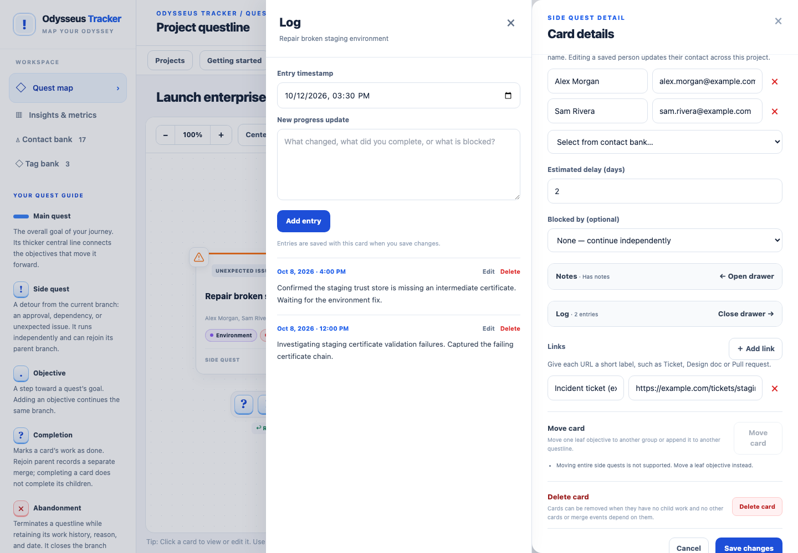

Notes and Log share the auxiliary-drawer space, so opening one closes the other. Adding a log entry updates the current editor draft. Finish with **Save changes** to apply it to the card; **Cancel** discards the draft. Save or discard pending log-entry text before saving the card. Notes and log entries do not render Markdown.

## 6. Reuse contacts and colored tags

Open **Contact bank** to manage people for the project. Assign an existing contact in a card or add a new person with an optional email address. Multiple owners can be assigned to a card.

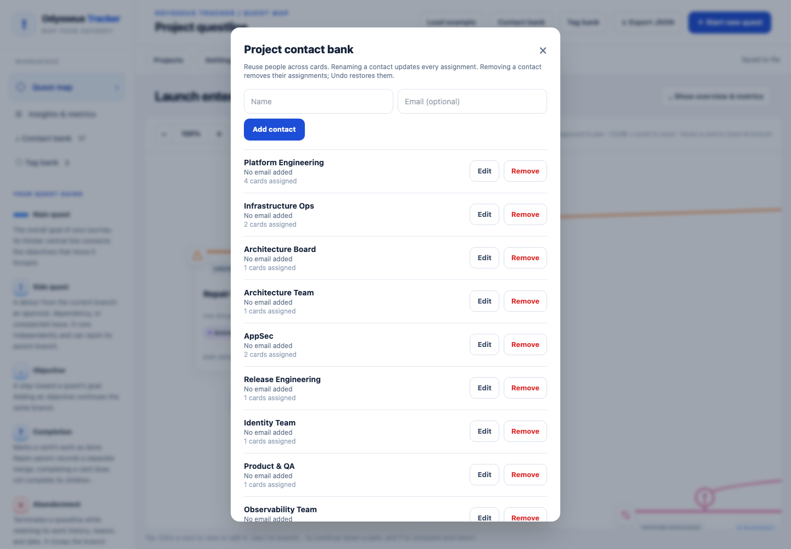

Renaming a shared contact updates its assignments. Removing an owner from a card keeps the contact in the bank; removing a contact from the bank clears that person's assignments across cards.

Open **Tag bank** to create reusable tags and choose a color. Updating a shared tag changes it across assigned cards. Removing a tag assignment keeps the tag available; removing a bank tag clears its assignments.

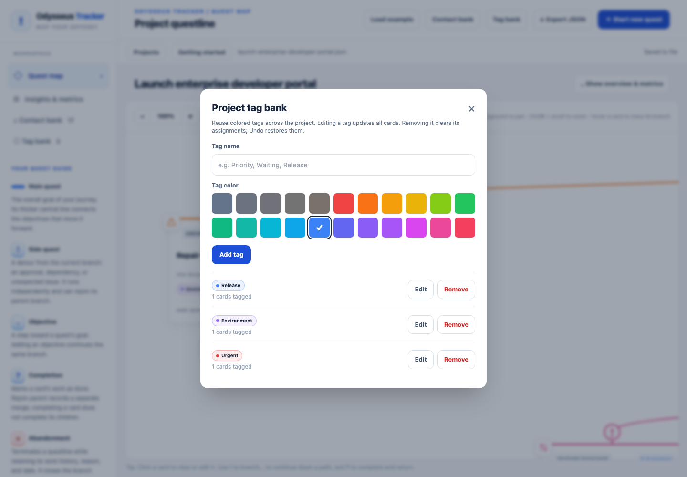

Contacts and tags belong to the active project. They travel with its file and JSON export.

## 7. Understand progress and delivery overhead

The project overview shows total objectives, side-quest share, completion, and cumulative estimated delay. Use **Insights & metrics** for a fuller view of the project's work and progress.

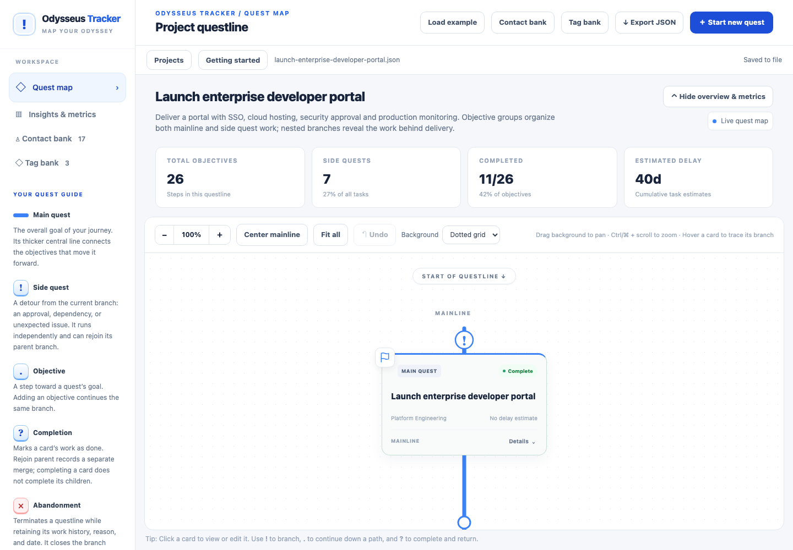

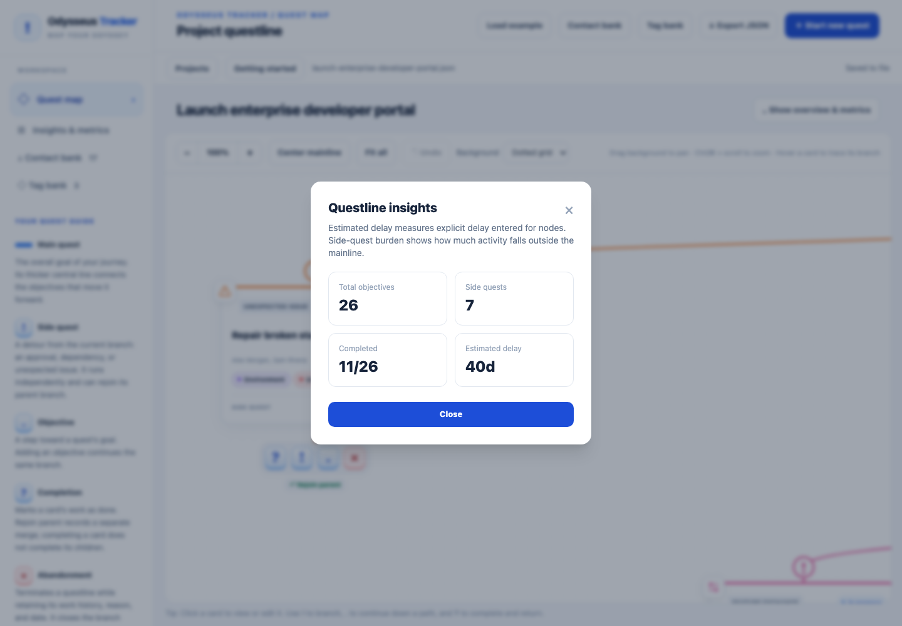

Delay values are manually entered estimates added across work. Parallel tasks can overlap, so these totals are not predicted elapsed time or a critical-path schedule. Use them to understand the recorded workload and supporting effort.

## 8. Choose your background

The map toolbar's **Background** selector offers:

| Choice | Appearance |
| --- | --- |
| Dotted grid | The default dotted canvas |
| None | A plain canvas |
| Backdrop | The bundled `map.png`, centered and scaled to cover the viewport |

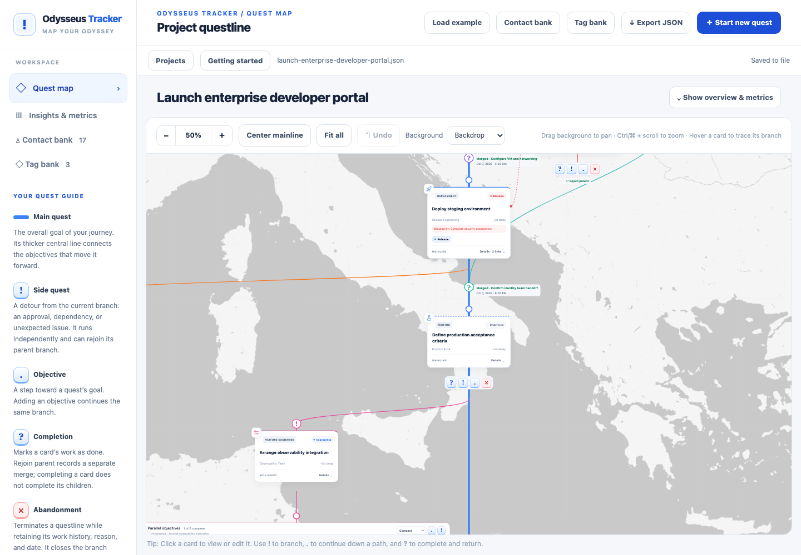

This is an application preference, saved in `config.yaml`. It does not change graph positions, project JSON, exports, or Undo history. In static browser mode it is remembered in browser storage; embedded previews keep the choice for the session.

## 9. Manage local projects and backups

Open **Projects** to choose an existing file or create another project. Each project has its own JSON file. Its initial title determines the filename; later title edits keep that filename stable. Duplicate titles create separate filenames.

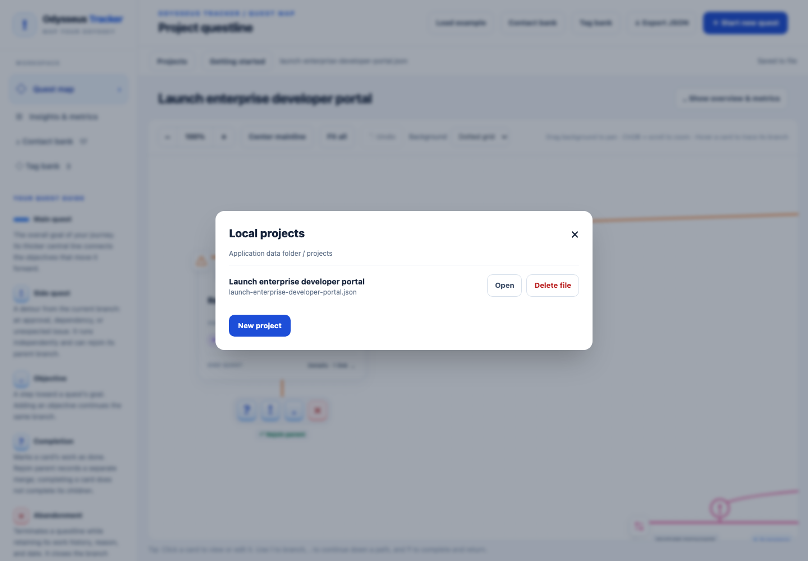

The app resumes the last selected project when restarted. Switching projects waits for file saves and requires an open editor to be saved or canceled. **Delete file** removes an entire project after confirmation and cannot be undone. Export a copy first when you want to retain it.

Use **Export JSON** to download the live project's data. Back up project files and configuration separately as needed. See the [local application guide](LOCAL-APPLICATION.md#bring-existing-browser-data-across) for bringing existing browser-saved data or compatible exports into the projects folder; there is no import dialog yet.

## 10. Correct placement and preserve history

**Undo** restores up to 50 prior edits in the active project's current session. Ctrl/⌘ + Z also works outside text inputs and active dialogs. Creating or opening another project clears this history, and it does not survive a restart.

A card's placement controls can move an eligible **leaf objective** to another open group's parallel work or another questline's endpoint. Choose a destination, review **From / To**, then confirm. Identity, content, timestamps, and blocker references stay with the card. Undo restores the original placement.

Deletion removes one eligible card at a time. Roots, children, blocker dependents, parallel anchors, merge records/anchors/origins, and abandonment records protect cards from deletion. Moves also protect side quest roots and closed questlines. When an action is unavailable, the editor explains the reason. Arbitrary drag-and-drop ordering, whole-branch moves, and cascade deletion are outside the current feature set.

Use abandonment to record terminated work rather than erase it. It requires a reason and valid date/time, preserves previous work, and closes further progression on that questline. Completing work, rejoining a branch, abandoning work, and deleting a card have different meanings.

## 11. Recover from a save problem

Watch **Saving…** and **Saved to file** in the local-app bar. Applied edits remain in memory while background saves run. If writing fails, editing stays available and a visible error offers **Retry save**, **Reopen saved file**, and **Export JSON**.

Export the live state before discarding changes. Retry after resolving a write problem. If the file changed outside the current tab, export your edits and reopen the saved file before saving again; stale revisions are rejected to protect newer disk content. Reopening explicitly discards unsaved memory changes after confirmation. Project switching refuses unresolved save failures.

For file locations, command-line options, configuration, and migration, see [Local application guide](LOCAL-APPLICATION.md). For implemented product rules and safeguards, see [Requirements](REQUIREMENTS.md).

## 12. Export an expanded map as PDF

Select **Export PDF** in the header. Save or cancel any open editor first. The app opens a separate print view with every card expanded, full-size parallel groups, a plain background, and a notes/log appendix. It exports your applied in-memory work even if a disk save has failed.

In the browser print dialog, choose **Save as PDF**. Keep the document's page sizes, use 100% scale, and turn off browser headers and footers. Check the preview before saving: the map occupies one large page for digital viewing, followed by A4 pages containing full notes and logs. Zoom into the saved PDF to read large maps. Printing the map on ordinary paper may shrink it considerably.

If your browser blocks the new window, allow pop-ups for the local app and try again. Canceling print leaves the preview open; **Print / Save as PDF** opens the dialog again. Live card expansion, group density, zoom/pan, saved data, and Undo stay unchanged. The print snapshot does not update when you continue editing the project; export again for a fresh copy.

Very large maps exceeding 18,000 CSS pixels in width or height show a preparation error. This first version does not tile a map across ordinary paper pages. Browser settings and mixed page-size support vary; Chromium PDF output is covered by the automated checks.
